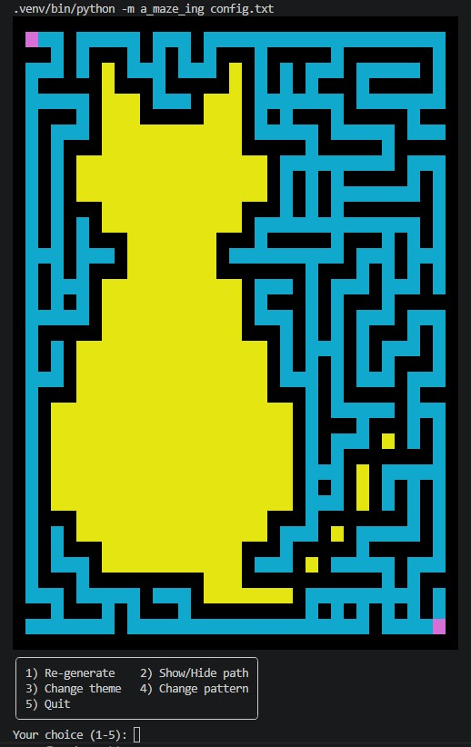
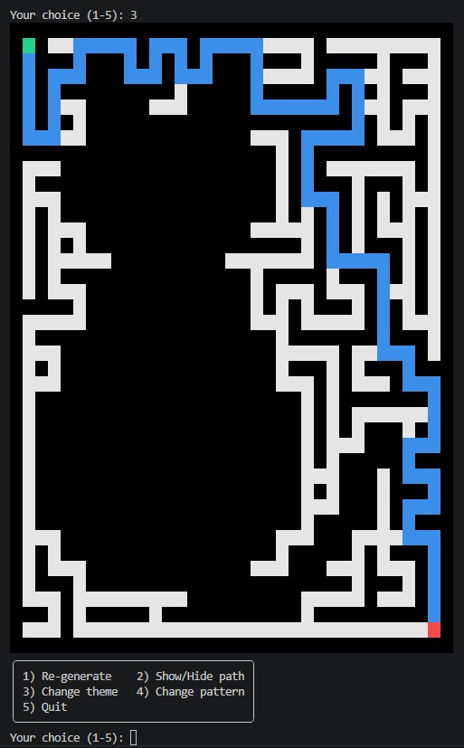
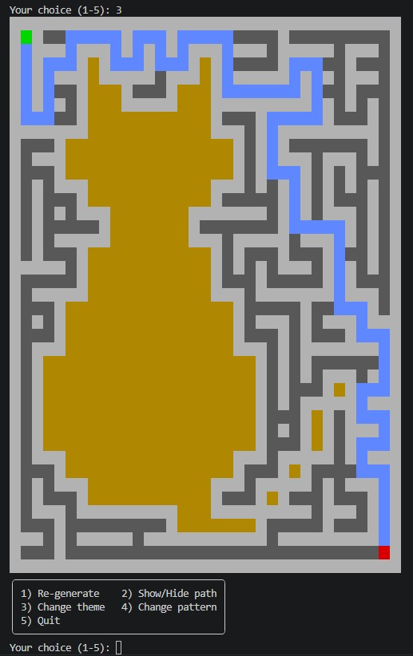
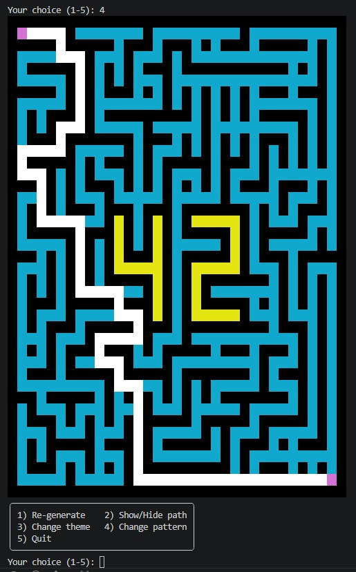
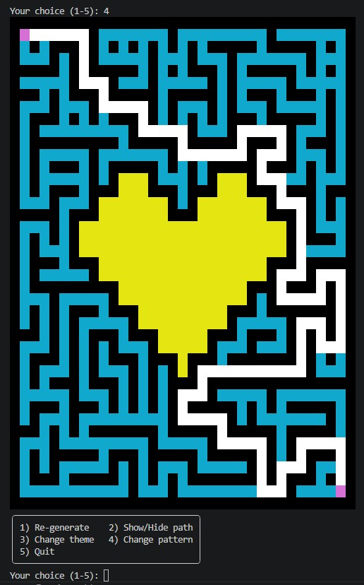

# 42_M03: A-Maze-Ing



## Table of Contents
- [Description](#description)
- [Instructions](#instructions)
	- [Basic compilation + execution with Makefile](#basic-compilation--execution-with-makefile)
	- [Reusable package](#reusable-package)
- [Resources](#resources)
- [Implementation](#implementation)
	- [Maze generation algorithm](#maze-generation-algorithm)
	- [Visualization](#visualization)
- [Project Management](#project-management)

___

## Description
This project was created by 2 students of 42Prague ([adgomez/Aditoo17](https://github.com/Aditoo17), [ssucha/vincent-syma](https://github.com/vincent-syma/)) as a school assignment.

It consists of a program showcasing a **random maze generator** with output displayed on the terminal. The maze generator is made as a **[reusable package](#reusable-package)** you can install and use in other projects.

### Input
* The program is configured using a **configuration file** given to the program as an argument.
* The following configuration options are available:
    * The **dimensions**, **entry and exit points** of the maze can be customized.
    * The maze can be set to be **perfect** (no looping passages; only one path from entry to exit) or **imperfect** (passages can loop around; multiple paths from entry to exit are possible).
    * The maze will contain a specified **pattern in the middle**. The default pattern is a number 42.
    * Any random maze with specific settings can be reproduced with a **seed**.

### Output
* The program will display the **resulting maze**, along with the **shortest path from entry to exit**, on the terminal, and output data about the maze to an output file `maze.txt`.
* This file contains:
    * **The layout of the maze**, with each cell represented by a hex digit that encodes which sides of the cell have a wall and which can be passed through
    * The coordinates of the maze's **entry and exit points**
    * **The shortest path from entry to exit**, represented by a string of the characters ``"NESW"``, each indicating a compass direction in which to move through the maze

## Instructions

### Basic compilation + execution with Makefile

The Makefile uses `config.txt` as a configuration file.
It contains all available keywords including the optional ones.

```bash
make install					# install dependencies
make venv-install				# install venv and dependencies

# ----------------------------------------------------------------
make / make all / make run		# run the program
# ----------------------------------------------------------------

make debug						# run in a debug mode
make lint						# checks the code with flake8 and mypy
make lint-strict				# checks the code with flake8 and mypy in a strict mode

make clean						# delete temporary files and caches
make venv-clean					# delete venv
make fclean						# delete temporary files and caches + venv
make re							# make fclean and make all together

make help						# show all MAKE options
```

### Reusable package

#### Installation

Install the maze generator packages including all required dependencies from `packages` folder into your global environment or project venv:

```bash
pip install mazegen-1.0-py3-none-any.whl
# or
pip install mazegen-1.0.tar.gz
```

In case you make adjustments to the source code, delete the `packages` folder and generate updated packages into `dist` folder:

```bash
make install		# install dependencies
# or
make venv-install	# install venv and dependencies

make build		# create a .whl and .tar.gz packages
```

#### Usage

```python
# instantiates the maze generator with config file as argument
generator = MazeGenerator.from_cli(sys.argv)

# generates new maze and puts the result in the chosen output file
generator.generate()

# creates visual representation of the output file with chosen color theme
maze = generator.render_maze_visual(show_path=False)
print(maze)
```

## Resources
* [Maze algorithm descriptions](https://professor-l.github.io/mazes/)
* [Breadth-first search explanation](https://en.wikipedia.org/wiki/Breadth-first_search)
* Consulting with LLMs (ChatGPT, Claude):
	- `rich` functionalities
	- `Makefile` upgrades for dependencies
	- debugging


## Implementation
### Maze generation algorithm
To implement the random maze generation, we used a `randomized backtracking` algorithm.

This backtracking algorithm creates a perfect maze. When creating an imperfect maze, the algorithm also has a 1/4 chance of creating a passage in a random direction from the current cell.

Since a perfect maze only has one solution, its path is saved during maze generation. For an imperfect maze, the shortest path is calculated after generation using `breadth-first search`.

### Visualization

#### Color themes
There are 4 different color themes defined un `utils/color_themes.py`:
- default
- neon
- pastel
- mono

They can be modified.

User can choose the theme in the `config file`.
If it is not specified, it is set to the `default` theme.

The themes can also be changed after running the program by choosing option 3 from the menu (`Change theme`).




#### Patterns
According to the subject we have to implement 42 pattern inside the maze. We made this part modifiable so the pattern can be changed to the different one or switched off.

Patterns are defined in `utils/patterns.py` and they also can be modified.

User can choose the pattern in the `config file`.
If it is not specified, it is set to the `cat` pattern.




For now this functionality works only for patterns without holes inside of them. In the future we would love to improve the rendering algorithm to be able to handle more sophisticated patterns and add other possibilities like allignment (now it is always in the center).

## Project management
### adgomez
- maze and path algorithms
- output file formatting
- package creation
- README

### ssucha
- input parsing and validation
- visualization via terminal
- main program
- Makefile